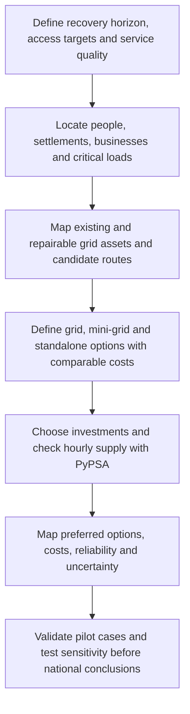

# Overall plan: where should Sudan connect, rebuild or supply locally?

[Start here](../README.md) · [Evidence and missing inputs](EVIDENCE_AND_GAPS.md) · [Data collection](../data/README.md)

## The question and intended output

**For a defined recovery horizon and electricity service target, which combination of grid rehabilitation/extension, mini-grids and standalone systems supplies existing and newly served demand in Sudan at the lowest system cost?**

The intended result is a **map of demand clusters and preferred service options**, with connection routes, capacity, costs, households/people served, reliability and uncertainty. A second map should show where the preferred option changes under plausible assumptions. Neither map exists yet.

The 2022 system is a pre-war reference. Recovery scenarios transform that reference into alternative starting conditions; they do not imply a known date for the end of the war. A five- or ten-year recovery horizon can be an explicit study assumption, with calendar dates assigned when the scenario is defined.

## The study from top to bottom

Two scales must connect: the **national/regional electricity system** and **local settlement access**. The current 19-node model represents the first approximately. A locality table is context; village-scale choices need georeferenced demand clusters and viable routes.

## What each option means

| Primary service option | Assets/costs to include | Questions that can change the result |
|---|---|---|
| **Grid rehabilitation or extension** | Repairs, upstream supply/reinforcement where needed, route construction, transformers, distribution, connections, losses and operation | Is the nearest line usable with enough capacity? Is another route preferable? Can settlements share a trunk route? |
| **Mini-grid** | Local generation, storage/backup, fuel delivery, shared distribution, connections and replacements | Does settlement density justify distribution? Can it meet evening, seasonal and productive loads? |
| **Standalone supply** | Household/facility equipment, batteries, maintenance/replacement and delivery; no shared settlement distribution | What appliances, peak power and service hours can it support? Do productive loads need a separate solution? |

A mini-grid has its own local network. Standalone means separate household/facility systems. Grid-connected places may also use local PV or batteries. Classification describes the primary service arrangement without banning hybrid supply or later grid connection.

Do not assign an option in advance because a district is remote, populous or sunny. These characteristics affect feasibility/costs; the comparison determines the result. We have not established which named locations belong in each category.

## Can PyPSA do this?

**Yes, as the energy-system optimization engine in an explicitly designed spatial planning workflow.** PyPSA supports investment in generation, storage and network capacity, given candidate assets and limits. See [capacity constraints for the installed PyPSA 1.0.6](https://docs.pypsa.org/v1.0.6/user-guide/optimization/capacity-limits/).

Settlement technology choices, route activation, repair decisions and connection charges are additional planning logic. PyPSA's underlying optimization model can be extended with custom variables and constraints; loading the present network will not automatically generate an electrification map. See [PyPSA 1.0.6 custom constraints](https://docs.pypsa.org/v1.0.6/user-guide/optimization/custom-constraints/).

I recommend a **GIS and demand layer feeding PyPSA**, with an explicit option-selection layer. [OnSSET](https://onsset.readthedocs.io/en/latest/) is an established geospatial electrification tool comparing grid extension, mini-grid and standalone options. It is a methodological reference or possible linked tool, **not currently installed or integrated here**. Coupling it to PyPSA would require designed data exchanges and consistency checks.

| Layer | Responsibility | Proposed implementation |
|---|---|---|
| **Spatial evidence** | Settlements, access, population, routes, terrain and resources | GIS processing and a documented demand-cluster table |
| **Option selection** | Service arrangement per settlement; route repair/build decisions | Explicit pilot comparison first; then discrete choices with shared-route costs or a carefully linked geospatial model |
| **Energy and capacity** | Generation, storage, imports, transfers and hourly adequacy | PyPSA investment/dispatch model extending the fixed-capacity prototype |
| **Evaluation** | Access, reliability, costs, sequencing and uncertainty | Reproducible scenario tables, maps and validation sections |

This is proposed architecture, not a description of functionality already implemented in the notebooks.

## A fair economic comparison

Compare feasible options over the **same service specification, horizon and cost basis**. Minimize discounted lifecycle system cost, including investments/repairs, operation, fuel and replacements, subject to reliability requirements. Historical sunk construction costs should not be charged again as new investment. Tariffs and subsidies are not substitutes for economic resource costs.

Grid options must include upstream supply and connections; mini-grids must include distribution; standalone systems must meet assigned service requirements. Comparing a small solar-home package against full grid service on price alone answers the wrong question. If access tiers differ, make them explicit scenarios rather than silently reducing demand for the cheapest option.

For the pilot, enumerate complete candidate service arrangements and optimize their sizes/operation. Shared routes and upstream constraints make settlements interdependent at national scale. A per-settlement cheapest-option screen alone does not establish a global least-cost plan.

An integrated formulation can add one primary service choice per cluster and period, route-build/repair variables, capacity and operating constraints. Charge fixed costs when options are chosen: a cheap fractional `Link` without activation costs can otherwise produce unrealistic extensions. Tie flows, existing assets and local generation to those choices. Explicitly export and check custom variables and constraints.

A staged approach can iterate local choices with regional supply/network costs. If used, document its algorithm and convergence and benchmark it against a small jointly optimized case; do not call an unverified screen a global optimum. Planning results also do not replace detailed distribution design or protection studies.

## Milestones and completion criteria

| Stage | Deliverable | Complete when | Status |
|---|---|---|---|
| **0. Make the project readable** | Project map, evidence register and notebook guides | Evidence, calibrated results, assumptions and proposed work are visibly distinguished | **Available** |
| **1. Prepare reference and pilot inputs** | Reconciled 2022 fleet; hydro-seasonality upgrade; small mapped settlement sample; service and cost tables | Years/definitions/units agree; unknowns have bounds; assets and demand are not double counted | **Next** |
| **2. Demonstrate a fair comparison** | Representative clusters with grid, mini-grid and standalone alternatives | Feasible options meet service targets; costs reconcile; limiting cases behave plausibly; shared routes and upstream assumptions are exposed | **Planned** |
| **3. Couple access and regional supply** | Repair, capacity, network and connection decisions | Balances, service, capacity and budgets pass; small cases are checked independently; screening is distinguished from joint optimization | **Planned** |
| **4. Scale and stress-test** | Regional/national maps across recovery, demand, fuel, hydro, cost and finance cases | Robust/uncertain choices are visible; chronological storage and seasonal adequacy are checked; spatial coverage is reported | **Planned** |
| **5. Paper release** | Archived data/version, methods, validation and reproducible notebook | Claims match evidence; holdout/local checks, uncertainty, limitations and source rights are documented | **Planned** |

Choose pilot clusters after reviewing actual locations and coverage. Near-grid, dense remote and dispersed rural are useful **case types**, not conclusions about named regions. Synthetic cases can test software but must be labelled and cannot validate geographic recommendations.

## Results for the paper

- Preferred option by cluster, including alternatives that are nearly as cheap.
- Households/people served and critical/productive loads, with a stated service standard.
- Investment and lifecycle costs; cost per connection and delivered energy with clear denominators.
- Repairs, network kilometres, generation/storage additions and timing.
- Reliability, fuel/import dependence and emissions where supported.
- Choices stable across uncertainty, and locations needing better evidence.

The immediate goal is **a transparent, cost-complete pilot explaining why each option wins**. A national coloured map follows a credible comparison.

The existing pies show capacity or dispatch, not optimal electrification technologies. The report's projected access is not an optimized result. There is currently no measured post-war damage inventory or settlement-level choice optimizer in this repository. The stages above describe future work.
